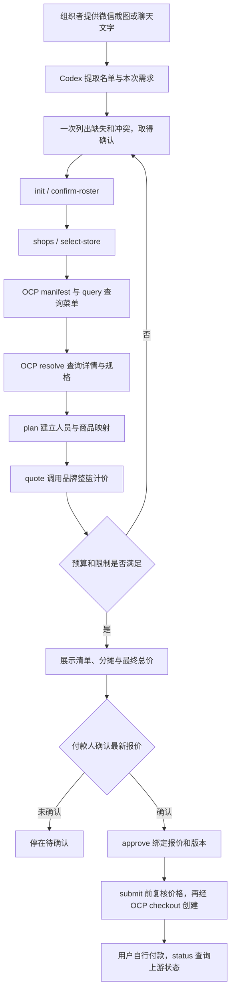

# 团餐管家：文件结构与执行流程

## 文件分别负责什么

|文件或目录|职责|
|---|---|
|`SKILL.md`|告诉 Codex 何时使用、如何理解需求、何时停止和如何取得真实购买授权|
|`agents/openai.yaml`|skill 在 Codex 中的名称、描述和默认提示|
|`references/commands.md`|命令、JSON 输入结构、金额单位、真实与模拟模式|
|`scripts/run.ps1`|定位 OCP 项目和 Bun，将命令转交团餐 CLI|
|`examples/milk-tea-app/src/group-cli.ts`|命令入口，读取 JSON、打开任务数据库并选择品牌适配器|
|`group-types.ts`|任务、人员、规格、报价、确认等数据结构和输入校验|
|`group-store.ts`|SQLite 任务和已确认偏好、版本号、提交记录|
|`group-manager.ts`|需求确认、配餐、报价、售罄局部重配、审批和提交状态机|
|`group-catalog.ts`|将品牌菜单和整单动作映射为 OCP manifest/query/resolve 接口|
|`group-provider.ts`|品牌规格映射、同 SKU 合并、整篮报价、创建和查询订单|
|`group-gateway.ts`|连接瑞幸或麦当劳 MCP，限制开放工具，读取本机加密凭证|
|`group-fixture.ts`、`group-demo.ts`、`group.test.ts`|不调用真实商家的模拟数据、演示与回归测试|
|`public/`|已有个人点单网页的 HTML、CSS、JS；团餐 skill 不依赖网页交互|

目前没有单独 `assets/` 目录。没有图像或模板资产需要复制到输出，所以没有创建空目录。可执行支持在 scripts，阅读资料在 references，运行时实现和已有网页资源在 examples。

## 一次任务如何执行



截图和聊天只是需求证据，不是执行授权。Codex 完成语言理解和选择；脚本执行确定的数据校验、版本控制和接口调用。`SKILL.md` 本身不会直接运行网络请求。

单次任务限制为一个品牌、一家门店、一个付款人、即刻到店自取。瑞幸查店要求经纬度；用户给地图链接后可提取坐标。商品名称和规格 ID 必须来自真实响应。如果“少甜”选项不存在，集中询问可用替代，不能悄悄改用默认甜度。

## 报价和售罄

逐人配餐先保留身份映射，上游整篮中同 SKU 才合并数量。整单总价来自品牌计价工具，不是搜索预估价相加。逐人金额按参考价比例分摊并修正到分，合计等于整单；它不是官方逐人交易价格。

明确售罄后 `unavailable` 标记 affected，`replace` 只接受这些人的新选择。其他人商品、规格、数量保持原样。随后重新报价并撤销旧审批。整单优惠重新分摊时，未换商品的人的展示金额仍可能改变。

## 防止重复提交

报价有效两分钟，审批绑定 quote_id、revision、总额和付款人。提交前再次计价，变化就重新展示并确认。调用真实创建之前先持久化提交标记；超时进入 unknown，禁止自动重试，先到官方 App 核对。成功后的重复 submit 只读取已保存结果。

## 安装与验证

在 OCP-Catalog 仓库根目录安装 Bun 依赖：

```powershell
bun install
bun run build # 生成 OCP 工作区声明与构建产物，供类型检查使用
$skillTarget=Join-Path $env:USERPROFILE '.codex\skills\team-meal-manager'
Copy-Item -Path '.\skills\team-meal-manager' -Destination $skillTarget -Recurse
$env:TEAM_MEAL_PROJECT=(Get-Location).Path
$runner=Join-Path $skillTarget 'scripts\run.ps1'
& $runner doctor
& $runner demo -Brand luckin
```

复制命令用于尚未安装该 skill 的机器；已有同名 skill 时先比较，避免覆盖个人调整。`TEAM_MEAL_PROJECT` 当前 shell 有效，重新启动后需再设置，或给 runner 传 `-ProjectRoot`。

`demo` 全部模拟，包含模拟提交，不产生真实订单。希望只展示报价时，按 commands.md 分步执行并停在 quote，不执行 approve/submit。

真实使用前在应用目录自行运行 `Save-GroupCredential.ps1 -Brand luckin` 或 `-Brand mcd` 配置凭证，再执行 doctor -Connect。DPAPI 凭证绑定 Windows 用户，不可复制给别人。

发布不包含 `data/`、`evidence/`、本机 `project.json`、真实聊天、报价记录、支付入口和凭证。用户需自行提供账号和位置。真实创建、付款、取餐不能由模拟测试证明。
